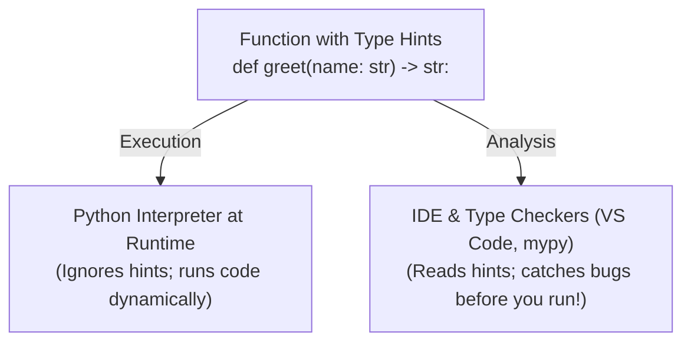

# Clearer Code with Type Hints

Python is a dynamically typed language: you never have to state the datatype a variable holds when creating it. This keeps Python code concise and agile. However, as your programs grow into multiple functions and files, code without explicit types can become ambiguous:

- Is `price` an `int`, a `float`, or a formatted `str` like `"$19.99"`?
- What happens if a lookup function can't find an item—does it return `0`, `False`, or `None`?
- Is `items` a `list`, a `dict`, or a `set`?

Without clues in the code, you are forced to read every line of a function's implementation just to understand what arguments it expects. 

**Type hints** (also called *type annotations*) allow you to document the expected data types directly within your code. They transform your function signatures into clear, self-documenting contracts.

---

## Lesson Overview {#overview}

By the end of this lesson, you will:

- Annotate function parameters and return values using standard types (`int`, `float`, `str`, `bool`, `None`).
- Provide type hints for parameters with default values.
- Understand the critical distinction between **dynamic runtime execution** and **static type checking**.
- Annotate collections using modern Python built-in generics (`list[str]`, `dict[str, float]`, `tuple[int, int]`, `set[str]`).
- Express missing values and alternative types using the modern union pipe operator (`int | None`, `int | float`).
- Inspect type annotations at runtime using the `__annotations__` dictionary.
- Define **Type Aliases** to keep complex signatures clean and readable.
- Know when to add type hints and when they can be omitted.

---

## Conceptual Overview

### Type Hints as a Contract

Think of a function's signature as a **contract** between the author of the function and whoever calls it:

1. **Parameters (`name: type`):** "Here is what this function requires from you."
2. **Return Value (`-> type`):** "Here is what this function guarantees to hand back to you."



### The Most Important Rule: Python Does Not Enforce Hints at Runtime

One of the most important concepts to remember is that **Python's interpreter ignores type hints when running your code**. 

Python does **not** raise a `TypeError` simply because you passed the wrong type into an annotated function. Instead, type hints are read by:

- **Code Editors (VS Code, PyCharm):** To provide accurate autocompletion, show helpful hover tooltips, and flag obvious mistakes as you type.
- **Static Type Checkers (`mypy`):** Standalone tools run before code execution to scan your entire codebase for type mismatches.
- **Fellow Developers:** Anyone reading your code can understand the function's expectations at a glance without guesswork.

---

## Your First Type Hints

To hint a function:
1. Place a **colon (`:`)** and the type name after each parameter.
2. Place an **arrow (`->`)** and the return type before the colon ending the `def` statement.

```python interactive debug
def greet(name: str, times: int = 1) -> str:
    return f"Welcome, {name}! " * times

message = greet("Alice", 2)
print(message)
```

Notice how each part works together:

| Part | Meaning |
| :--- | :--- |
| `name: str` | The parameter `name` should be a `str`. |
| `times: int = 1` | The parameter `times` should be an `int`, with a default value of `1`. |
| `-> str:` | The function promises to return a `str`. |

:::tip Default Values with Hints
When a parameter has a default value, always put the **type hint first**, followed by the equals sign and the default value:  
`times: int = 1` (never `times = 1: int`).
:::

### Built-in Basic Types

The type names you use for basic annotations are the same built-in types you already know:
- `int` — integers (e.g., `42`)
- `float` — floating-point numbers (e.g., `3.14`)
- `str` — text strings (e.g., `"book"`)
- `bool` — boolean values (`True` or `False`)

---

## Python Doesn't Enforce Hints

Let's test what happens when we pass an unexpected datatype to an annotated function:

```python interactive
def double(n: int) -> int:
    return n * 2

print(double(5))       # 10
print(double("ha"))    # "haha"
```

Notice that `double("ha")` runs without raising an error! Python sees `"ha" * 2`, performs string repetition, and outputs `"haha"`. 

The hint said `int`, but Python did not check it at runtime. If the function body had performed an operation exclusive to numbers (such as `n - 1`), Python would have raised a `TypeError`—caused by the subtraction operation itself, **not** by the type hint.

:::info Checking Hints with `mypy`
To catch mismatched types before running your program, professional Python developers run a static analysis tool called **mypy**:
```bash
mypy script.py
```
If `mypy` scans `double("ha")`, it immediately reports:
```text
error: Argument 1 to "double" has incompatible type "str"; expected "int"
```
:::

---

## Hints for Collections

In modern Python (Python 3.9+), standard collections can be parameterized directly with square brackets `[...]` to specify the types of elements they hold:

| Type Hint | Meaning | Example |
| :--- | :--- | :--- |
| `list[int]` | A list containing only integers | `[10, 20, 30]` |
| `dict[str, float]` | A dictionary with `str` keys and `float` values | `{"apple": 0.99, "bread": 2.50}` |
| `set[str]` | A set containing unique strings | `{"admin", "editor", "guest"}` |
| `tuple[int, int]` | A tuple of **exactly two** integers | `(1920, 1080)` |
| `tuple[str, ...]` | A tuple of **any length** containing strings | `("Ada", "Alan", "Grace")` |

:::warning Tuples: Fixed Length vs. Variable Length
Unlike `list[int]`, which accepts any number of integers, `tuple[int, int]` expects a tuple with **exactly two** integers. To annotate a tuple with an arbitrary number of items, use an ellipsis (`...`): `tuple[str, ...]`.
:::

Let's see collection hints in an interactive function:

```python interactive debug
def find_extremes(scores: list[int]) -> tuple[int, int]:
    return (min(scores), max(scores))

def calculate_inventory_value(stock: dict[str, int], prices: dict[str, float]) -> float:
    total = 0.0
    for item, count in stock.items():
        total += count * prices.get(item, 0.0)
    return total

test_scores = [88, 92, 79, 95, 84]
print("Min and Max:", find_extremes(test_scores))

store_stock = {"Python Book": 5, "Notebook": 12}
store_prices = {"Python Book": 29.99, "Notebook": 4.50}
print("Total Value: $", calculate_inventory_value(store_stock, store_prices))
```

---

## Missing Values and Multiple Types

### Values That Might Be Missing: `Type | None`

Often, a function might return a result or `None` if something was not found (such as looking up a key in a dictionary or searching a database).

In modern Python (3.10+), we use the pipe operator (`|`) to express this: `int | None` (read as *"an integer or None"*):

```python interactive
def find_user_age(username: str, users: dict[str, int]) -> int | None:
    return users.get(username)

records = {"alice": 28, "bob": 34}

print("Alice:", find_user_age("alice", records))
print("Charlie:", find_user_age("charlie", records))
```

By annotating the return type as `int | None`, any caller knows they must check if the result is `None` before performing calculations on it!

### Multiple Acceptable Types (Union)

The `|` operator also works between any types when a function can accept or produce multiple datatypes:

```python interactive
def format_identifier(id_code: int | str) -> str:
    return f"ID-{str(id_code).upper()}"

print(format_identifier(1024))
print(format_identifier("abc99"))
```

### Functions That Return Nothing: `-> None`

If a function performs an action (like printing to the terminal or writing to a file) and does not return a value, its return hint is `-> None`:

```python interactive
def log_message(prefix: str, message: str) -> None:
    print(f"[{prefix.upper()}]: {message}")

log_message("info", "Application loaded successfully.")
```

---

## Hints for Variables

You can also annotate variables directly with a colon:

```python interactive
# When starting with empty collections:
active_users: list[str] = []
config_settings: dict[str, bool] = {}

active_users.append("Sarah")
config_settings["dark_mode"] = True

print(active_users)
print(config_settings)
```

:::tip When to Hint Variables
You do **not** need to hint every variable in your program. If the assignment makes the type obvious (e.g., `age = 25` or `name = "Alice"`), type hints add clutter without adding new information. 

Reserve variable type hints for cases where the type isn't immediately obvious, such as empty collections (`items: list[str] = []`) or when a variable starts as `None` (`selected_item: str | None = None`).
:::

---

## Peeking Under the Hood: `__annotations__`

How does Python handle your type hints internally?

Python evaluates the type annotations and stores them in a special dictionary called `__annotations__` attached to the function or module:

```python interactive
def calculate_subtotal(price: float, quantity: int) -> float:
    return price * quantity

print(calculate_subtotal.__annotations__)
```

Output:
```python
{'price': <class 'float'>, 'quantity': <class 'int'>, 'return': <class 'float'>}
```

Notice that:
- Each parameter is a key pointing to its type object.
- The return hint is stored under the special key `'return'`.
- This dictionary is what automated test runners and tools inspect to verify your signatures!

---

## Expanding Your Toolkit

### Type Aliases

When a type annotation becomes long or repetitive, you can create a **Type Alias** by assigning the type to a descriptive variable name:

```python interactive
# Defining descriptive type aliases:
PriceMap = dict[str, float]
Coordinates = tuple[float, float]

def calculate_distance(point_a: Coordinates, point_b: Coordinates) -> float:
    dx = point_a[0] - point_b[0]
    dy = point_a[1] - point_b[1]
    return (dx**2 + dy**2) ** 0.5

origin: Coordinates = (0.0, 0.0)
target: Coordinates = (3.0, 4.0)

print("Distance:", calculate_distance(origin, target))
```

### Legacy Code: The `typing` Module

In code written before Python 3.9 and 3.10, you will often see types imported from Python's standard `typing` module:
- `from typing import Union, Optional, List, Dict, Tuple`

| Modern Syntax (Python 3.10+) | Older `typing` Module Syntax |
| :--- | :--- |
| `str \| None` | `Optional[str]` |
| `int \| float` | `Union[int, float]` |
| `list[str]` | `List[str]` |
| `dict[str, int]` | `Dict[str, int]` |

In modern Python codebases, prefer the modern built-in syntax. However, knowing the older syntax helps when reading existing open-source libraries and tutorials.

---

## Type Hints at a Glance

| Hint | Meaning | Example |
| :--- | :--- | :--- |
| `int`, `float`, `str`, `bool` | A single primitive value | `age: int = 25` |
| `list[T]` | A list containing elements of type `T` | `scores: list[int] = [95, 80]` |
| `dict[K, V]` | A dictionary mapping keys of type `K` to values `V` | `stock: dict[str, int] = {"pens": 10}` |
| `set[T]` | A set of unique items of type `T` | `roles: set[str] = {"admin", "user"}` |
| `tuple[T1, T2]` | A tuple of fixed size and types | `point: tuple[int, int] = (10, 20)` |
| `tuple[T, ...]` | A tuple of arbitrary length of type `T` | `names: tuple[str, ...] = ("A", "B")` |
| `T \| None` | An optional value: either `T` or `None` | `def find(id: int) -> str \| None:` |
| `T1 \| T2` | A union: value can be `T1` or `T2` | `def parse(val: int \| str) -> str:` |
| `-> None` | The function does not return a value | `def log(msg: str) -> None:` |

---

## Deepen your Knowledge

:::explore
**Learn More: Official Documentation & Standards**

Read through the following resources to master how modern type hinting works:

1. Read the [**Python Tutorial: Function Annotations**](https://docs.python.org/3/tutorial/controlflow.html#function-annotations) (Section 4.8.8) to see how annotations are defined in Python's official specification.
2. Read the official [**Standard Library `typing` Documentation**](https://docs.python.org/3/library/typing.html). Focus on the introductory section explaining type aliases and modern generics.
3. Review [**PEP 604 – Allow writing union types as X \| Y**](https://peps.python.org/pep-0604/) to understand how Python 3.10 replaced `Union` and `Optional` with the pipe operator.
4. Read the [**Mypy Type System Cheat Sheet**](https://mypy.readthedocs.io/en/stable/cheat_sheet_py3.html) to see how static type checkers analyze Python code.
:::

---

## Check Knowledge

Test your understanding with these questions. Some questions will require researching the links above:

1. If you annotate a function with `def calculate(n: int) -> int:`, what happens at runtime if someone passes `"10"` (a string) as the argument? Does Python raise a `TypeError`?
2. What is the difference between the type hints `tuple[int, int]` and `tuple[int, ...]`?
3. What is the modern (Python 3.10+) equivalent of writing `Optional[str]` from the `typing` module?
4. How do you correctly annotate a parameter that has a default value? Show the exact order of parameter name, type hint, and default value.
5. In what dictionary does Python store a function's evaluated type annotations, and under what key is the return type annotation kept?
6. When should you annotate local variables inside a function, and when should you omit variable type annotations?

---

## Exercise

Visit our [python-exercises repository](https://github.com/ThePythonLedger/python-exercises) to update your local copy and test your type hint skills:

1. Fetch and pull the latest changes from `upstream/main`.
2. Locate the exercise directory `exercises/foundations/07_type_hints`.
3. Run `pytest` to inspect the test suite.
4. Add the appropriate type hints to the target functions level-by-level, removing the `@pytest.mark.skip` decorator as you verify each level with `pytest`.

---

## Assignment {#assignment}

Return to your `simple-bookstore` project from previous lessons. In this assignment, you will make your codebase robust, professional, and self-documenting by adding type hints across all your functions and data structures.

You will complete this assignment on your local machine:

1. Open your `simple-bookstore` directory in your code editor.
2. Open `main.py` and annotate all function signatures with appropriate parameter and return types:
   - `calculate_subtotal(price: float, quantity: int) -> float`
   - `calculate_tax(subtotal: float, tax_rate: float = 0.07) -> float`
   - `apply_member_discount(subtotal: float, is_member: bool) -> float`
   - `format_receipt(store_name: str, item_name: str, quantity: int, total: float) -> None`
3. Add type annotations to your inventory and shopping cart structures:
   - Annotate your inventory price dictionary (e.g., `inventory_prices: dict[str, float]`).
   - Annotate your stock count dictionary (e.g., `inventory_stock: dict[str, int]`).
   - Annotate your shopping cart item list (e.g., `cart: list[str]`).
4. Create a function `lookup_book_price(catalog: dict[str, float], title: str) -> float | None`:
   - It looks up `title` in `catalog`.
   - Returns the price as a `float` if present, or `None` if the book is not found.
   - When calling this function in your purchase flow, verify with an `if price is not None:` check before processing the order.
5. Run your application with `python main.py` to ensure it continues to run smoothly.
6. Verify your type annotations in the Python REPL:
   ```python
   import main
   print(main.calculate_subtotal.__annotations__)
   ```
7. Stage, commit with a descriptive message (e.g., `git commit -m "Add type hints to bookstore functions and inventory structures"`), and push your changes to your remote GitHub fork.

---

## What's Next {#next-lesson}

With type hints in place, your functions are self-documenting, clear, and ready to be used safely across larger applications.

As our projects continue to expand beyond a single `main.py` file, how do we split our code into multiple organized files and reuse functions across different programs?

In the next lesson, we will explore **Modules and Packages** to master organizing Python code into modular, reusable components!
